# Day 51 – Kubernetes Manifests and Your First Pods

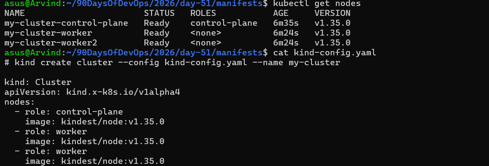

## The Anatomy of a Kubernetes Manifest

Every Kubernetes resource is defined using a YAML manifest with four required top-level fields:

```yaml
apiVersion: v1          # Which API version to use
kind: Pod               # What type of resource
metadata:               # Name, labels, namespace
  name: my-pod
  labels:
    app: my-app
spec:                   # The actual specification (what you want)
  containers:
  - name: my-container
    image: nginx:latest
    ports:
    - containerPort: 80
```

- `apiVersion` — tells Kubernetes which API group to use. For Pods, it is `v1`.
- `kind` — the resource type. Today it is `Pod`. Later you will use `Deployment`, `Service`, etc.
- `metadata` — the identity of your resource. `name` is required. `labels` are key-value pairs used for organization and selection.
- `spec` — the desired state. For a Pod, this means which containers to run, which images, which ports, etc.

---
## Challenge Tasks

### Task 1: Create Your First Pod (Nginx)
Create a file called `nginx-pod.yaml`:

```yaml
apiVersion: v1
kind: Pod
metadata:
  name: nginx-pod
  labels:
    app: nginx
spec:
  containers:
  - name: nginx
    image: nginx:latest
    ports:
    - containerPort: 80
```

Apply it:
```bash
kubectl apply -f nginx-pod.yaml
```

Verify:
```bash
kubectl get pods
kubectl get pods -o wide
```

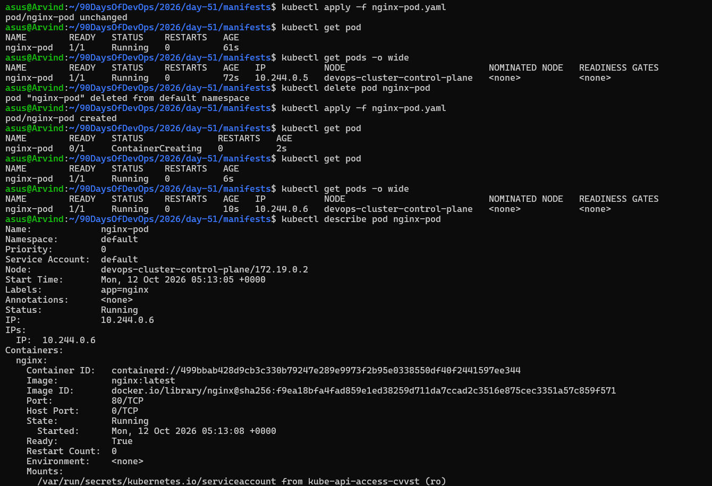

Wait until the STATUS shows `Running`. Then explore:

# Detailed info about the pod
```bash
kubectl describe pod nginx-pod
```
- It shows pod metadata, node & network info,container details,readiness/status,mounted volumes, scheduling constraints, and lifecycle events.


# Read the logs
```bash
kubectl logs nginx-pod
```
- It shows the container’s initialization,configuration steps and Nginx startup logs.


# Get a shell inside the container
```bash
kubectl exec -it nginx-pod -- /bin/bash
```

# Inside the container, run:
```bash
curl localhost:80
exit
```
**Verify:** Can you see the Nginx welcome page when you curl from inside the pod?

 - Yes i can see Nginx welcome page inside pod

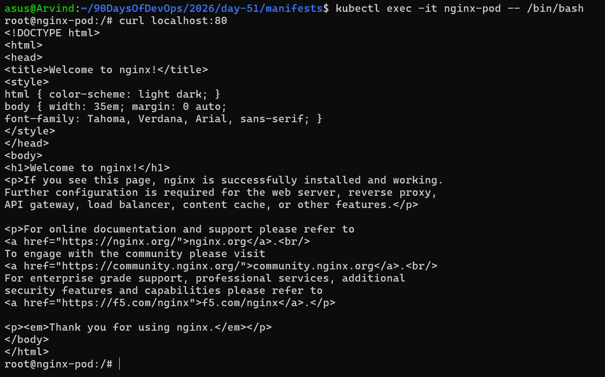

# Expose Nginx Pod and Access It in Browser (Kind Cluster)

### Step 1: Expose the Pod as a Service

```bash
kubectl expose pod nginx-pod --type=NodePort --port=80
```

### Step 2: Get the Service Details

```bash
kubectl get services
```

### Step 3: Access the Application Using Port Forwarding

In a Kind cluster, use port forwarding to access Nginx from your local browser.

```bash
kubectl port-forward pod/nginx-pod 8081:80
```

### Step 4: Open in Browser:

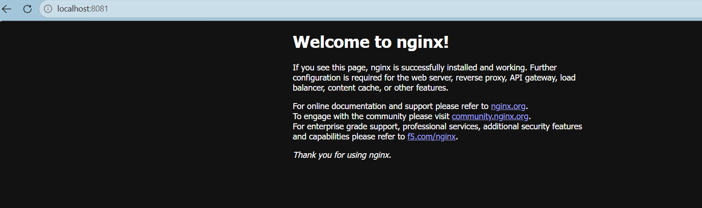


✅ **Expected Result:** The Nginx Welcome Page appears in your browser.

**Note:** Keep the terminal running while accessing the application. Press `Ctrl + C` to stop port forwarding.

---
### Task 2: Create a Custom Pod (BusyBox)
Write a new manifest `busybox-pod.yaml` from scratch (do not copy-paste the nginx one):

```yaml
apiVersion: v1
kind: Pod
metadata:
  name: busybox-pod
  labels:
    app: busybox
    environment: dev
spec:
  containers:
  - name: busybox
    image: busybox:latest
    command: ["sh", "-c", "echo Hello from BusyBox && sleep 3600"]
```

Apply and verify:
```bash
kubectl apply -f busybox-pod.yaml
kubectl get pods
kubectl logs busybox-pod
```

Notice the `command` field — BusyBox does not run a long-lived server like Nginx. Without a command that keeps it running, the container would exit immediately and the pod would go into `CrashLoopBackOff`.

**Verify:** Can you see "Hello from BusyBox" in the logs?

- yes

    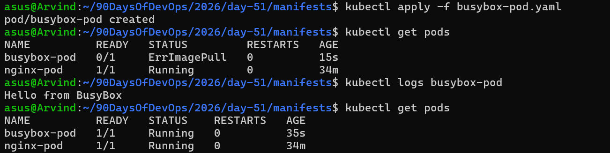

---
### Task 3: Imperative vs Declarative
You have been using the declarative approach (writing YAML, then `kubectl apply`). Kubernetes also supports imperative commands:

```bash
# Create a pod without a YAML file
kubectl run redis-pod --image=redis:latest

# Check it
kubectl get pods
```

Now extract the YAML that Kubernetes generated:
```bash
kubectl get pod redis-pod -o yaml
```

Compare this output with your hand-written manifests. Notice how much extra metadata Kubernetes adds automatically (status, timestamps, uid, resource version).

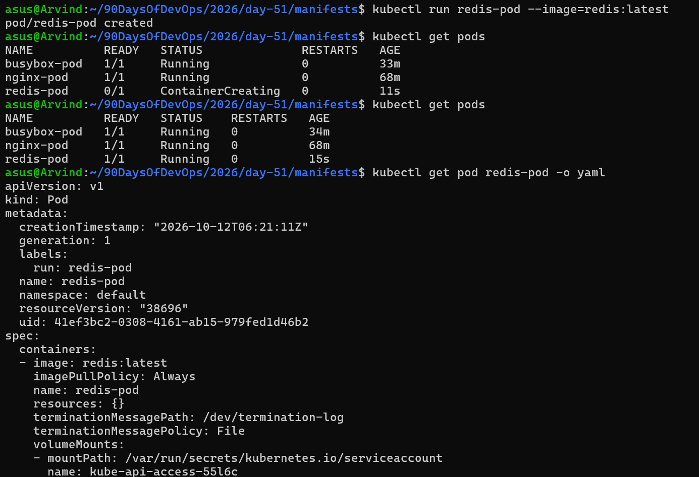

You can also use dry-run to generate YAML without creating anything:
```bash
kubectl run test-pod --image=nginx --dry-run=client -o yaml
```

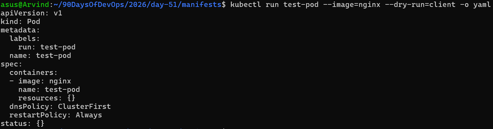

This is a powerful trick — use it to quickly scaffold a manifest, then customize it.

**Verify:** Save the dry-run output to a file and compare its structure with your nginx-pod.yaml. What fields are the same? What is different?

**Same fields:**

- apiVersion: v1
- kind: Pod
- metadata.name: nginx-pod
- metadata.labels.app: nginx
- spec.containers[0].name: nginx
- spec.containers[0].image: nginx:latest
- spec.containers[0].ports[0].containerPort: 80

**Different fields:**
- metadata.annotations
- creationTimestamp
- uid
- resourceVersion
- namespace
- spec.containers[0].imagePullPolicy
- resources
- terminationMessagePath/Policy
- volumeMounts
- spec.dnsPolicy
- restartPolicy
- enableServiceLinks
- nodeName
- schedulerName
- serviceAccount
- terminationGracePeriodSeconds
- tolerations
- volumesstatus


**Imperative (`kubectl run`)**

1. Creates resources immediately with a command.
2. Quick and good for testing;not stored as a file.

**Declarative (`kubectl apply -f`)**

1. Uses a YAML file to define desired state.
2. Versionable,repeatable,and preferred for production.

---

### Task 4: Validate Before Applying
Before applying a manifest, you can validate it:

```bash
# Check if the YAML is valid without actually creating the resource
kubectl apply -f nginx-pod.yaml --dry-run=client

# Validate against the cluster's API (server-side validation)
kubectl apply -f nginx-pod.yaml --dry-run=server
```

Now intentionally break your YAML (remove the `image` field or add an invalid field) and run dry-run again. See what error you get.

**Verify:** What error does Kubernetes give when the image field is missing?

- error get: `Error from server (BadRequest): container "nginx" in pod "nginx-pod" is waiting to start: trying and failing to pull image`

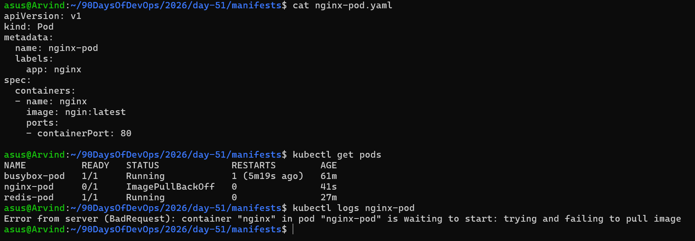

- issue resolved

 

---

### Task 5: Pod Labels and Filtering
Labels are how Kubernetes organizes and selects resources. You added labels in your manifests — now use them:


# List all pods with their labels
kubectl get pods --show-labels

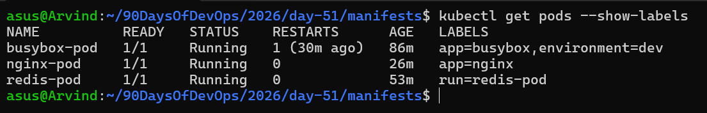

# Filter pods by label
kubectl get pods -l app=nginx
kubectl get pods -l environment=dev

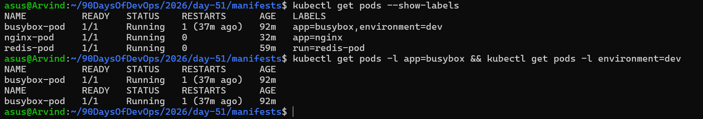

# Add a label to an existing pod
kubectl label pod nginx-pod environment=production

# Verify
kubectl get pods --show-labels

# Remove a label
kubectl label pod nginx-pod environment-


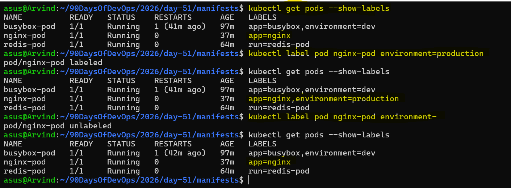

Write a manifest for a third pod with at least 3 labels (app, environment, team). Apply it and practice filtering.

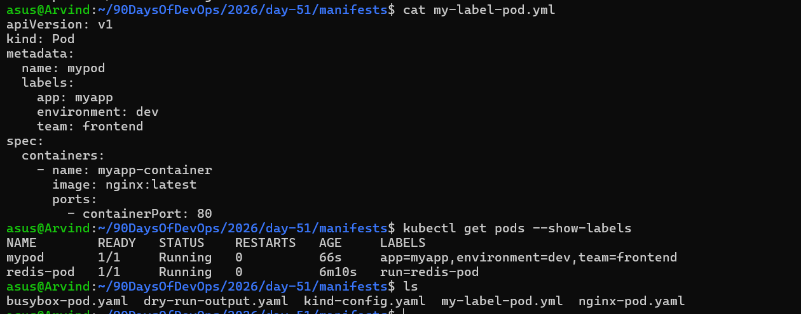

---

### Task 6: Clean Up
Delete all the pods you created:

```bash
# Delete by name
kubectl delete pod nginx-pod
kubectl delete pod busybox-pod
kubectl delete pod redis-pod

# Or delete using the manifest file
kubectl delete -f nginx-pod.yaml

# Verify everything is gone
kubectl get pods
```

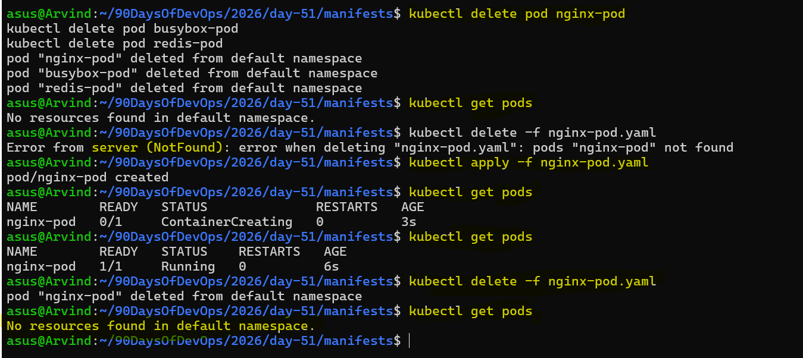

**What happens when you delete a standalone Pod?**
- when you delete a standalone Pod, it is gone forever. There is no controller to recreate it.
- This is why in production you use Deployments instead of bare Pods.

Question: Why do we use Deployments instead of standalone Pods in Kubernetes?

Answer:

A standalone Pod is not managed by a controller. If we delete it or it fails, Kubernetes does not automatically recreate it.

In production, we use Deployments because they manage Pods through ReplicaSets and maintain the desired number of replicas. If a Pod fails or is deleted, a new Pod is created automatically.

Example: If we configure 3 replicas and one Pod gets deleted, Kubernetes creates a new Pod to maintain 3 replicas.

Remember: Standalone Pod → No automatic replacement. Deployment → Automatic replacement to maintain the desired replica count.

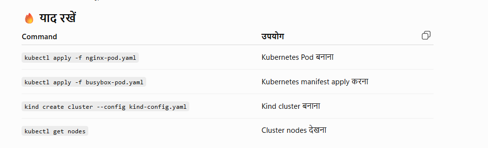

---
